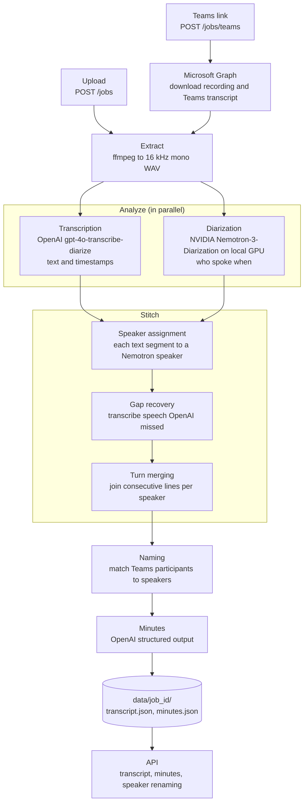

# Meeting Transcription API

A service that turns a meeting recording into a speaker-attributed transcript and structured minutes of meeting.
Recordings can be uploaded directly or imported from Microsoft Teams through Microsoft Graph.

## Architecture



## Overview

The service accepts any audio or video file that ffmpeg can read and produces three outputs:

| Output | Description |
| --- | --- |
| Transcript | Text with start and end times for every turn |
| Speaker attribution | Each turn labelled `speaker_0`, `speaker_1`, and so on, with optional real names |
| Minutes | Title, summary, key points, decisions, action items, open questions and suggested speaker names |

Processing runs as a background job. Clients submit a recording, receive a job ID immediately, and either poll the
job or subscribe to a server-sent event stream until it completes.

## Models

No single model produces accurate text and accurate speaker separation together, so the service combines three.

| Task | Model | Runs on | Reason for the choice |
| --- | --- | --- | --- |
| Speech to text | OpenAI `gpt-4o-transcribe-diarize` | OpenAI API | High word accuracy with segment-level timestamps. It also returns its own speaker labels, but these frequently merge two people into one, so they are used only as a secondary signal. |
| Speaker diarization | [`nvidia/Nemotron-3-Diarization`](https://huggingface.co/nvidia/Nemotron-3-Diarization) | Local GPU, through Transformers | A dedicated diarization model that separates voices more reliably than the transcription model. It processes the full recording in one pass, so speaker labels remain consistent across the whole meeting, and it has no per-request cost. |
| Minutes | OpenAI, set by `MINUTES_MODEL` | OpenAI API | Summarisation requires a general language model. Structured output guarantees the response matches the `Minutes` schema. |

In short, the words come from OpenAI and the speakers come from Nemotron.

## Processing pipeline

Each job moves through the following stages:

```
queued -> downloading (Teams imports only) -> extracting -> analyzing -> stitching -> minutes -> done
```

A job that fails at any stage is marked `failed`, with the stage recorded in `error_stage`.

### 1. Extracting

ffmpeg converts the source file to 16 kHz mono PCM (`audio.wav`), the format both models expect.

### 2. Analyzing

Transcription and diarization run concurrently on the same audio.

- **Transcription.** OpenAI limits uploads to 25 MB. Recordings longer than 12 minutes are therefore split into
  chunks of roughly 10 minutes, with each cut placed at the nearest silence so that no word is divided. Up to
  `TRANSCRIBE_CONCURRENCY` chunks are sent in parallel and their timestamps are shifted back onto the full timeline.
- **Diarization.** Nemotron always receives the complete recording. Splitting it would allow the same person to be
  given different labels in different chunks.

### 3. Stitching

The two outputs are combined into a single transcript.

1. **Speaker assignment.** Each OpenAI segment keeps its text exactly as returned and is assigned to the Nemotron
   speaker it overlaps most. OpenAI's own speaker labels are used to resolve ambiguous cases:
   - Overlap is weighted by how often each Nemotron speaker carries the segment's OpenAI label across the meeting.
   - A short segment (up to 2 seconds) whose OpenAI label differs from the segments on both sides is treated as an
     interjection and is not given to the person being interrupted, provided another plausible speaker overlaps it.
   - A segment during which Nemotron detected no speech takes the speaker of the nearest segment with the same OpenAI
     label, then the speaker most associated with that label, then the nearest Nemotron speaker.
2. **Gap recovery.** Speech that Nemotron detected for at least `GAP_MIN_SECONDS` but that no OpenAI text covers is
   cut out, transcribed on its own and attributed to that speaker. This recovers speech the transcription model drops,
   for example under laughter.
3. **Turn merging.** When two people talk over each other in fragments shorter than one second, each person's
   fragments are regrouped first. Consecutive segments from the same speaker are then merged into turns.

Overlapping speech is never cut up and re-transcribed. Very short or overlapping clips cause the transcription model
to invent text, which is also why gap recovery ignores regions shorter than `GAP_MIN_SECONDS`.

### 4. Naming

For Teams imports that have a speaker-attributed Teams transcript, each Teams participant is matched to the Nemotron
speaker they overlap most, with at most one name per speaker. Names can also be set or corrected at any time through
the API.

### 5. Minutes

The transcript, with any known names applied, is sent to the minutes model. The model is instructed to use only what
is said in the transcript and not to invent facts, owners or dates. For speakers that are still unnamed it may
suggest a name, together with the quote that supports the suggestion. Suggestions are never applied automatically.

## Requirements

| Requirement | Notes |
| --- | --- |
| Python 3.11 or later | |
| ffmpeg and ffprobe | Must be available on `PATH` |
| NVIDIA GPU with CUDA | Required for practical diarization speed. Apple `mps` and CPU are supported but slow. |
| OpenAI API key | Must have access to the transcription and minutes models |
| Hugging Face CLI (`hf`) | Installed with `huggingface_hub`, used to download the diarization model |

## Installation

```bash
python3 -m venv .venv
source .venv/bin/activate
pip install -r requirements.txt
./download_model.sh
cp .env.example .env
```

Then set `OPENAI_API_KEY` in `.env`.

Notes:

- Transformers is installed from source because Nemotron 3 Diarization support is not yet in a PyPI release.
- `download_model.sh` fetches only `config.json`, `processor_config.json` and `model.safetensors` (about 400 MB) into
  `models/nemotron-3-diarization`. If that directory is missing, the model is downloaded from the Hugging Face Hub on
  first start.

## Running the service

### API server

```bash
source .venv/bin/activate
uvicorn app.main:app --host 0.0.0.0 --port 8001
```

The diarization model is loaded at startup, so the first request is not delayed. Interactive API documentation is
available at `http://localhost:8001/docs`.

To keep the server running after disconnecting from a remote host such as EC2, start it inside tmux:

```bash
tmux new -s meeting
source .venv/bin/activate
uvicorn app.main:app --host 0.0.0.0 --port 8001
```

Detach with `Ctrl+B`, then `D`. Reattach with `tmux attach -t meeting`.

### Temporary public URL

A Cloudflare quick tunnel exposes the server over HTTPS without opening ports:

```bash
tmux new -s tunnel
cloudflared tunnel --url http://localhost:8001
```

To print the current URL later:

```bash
tmux capture-pane -pt tunnel -S -500 | grep -o 'https://[a-z0-9-]*\.trycloudflare\.com' | tail -1
```

The URL changes each time the tunnel restarts. The API has no authentication, so anyone with the URL can submit jobs
and read results. Use the tunnel only for short-lived testing.

### Command line

The command-line runner processes one file without starting the server and prints the transcript, minutes and
statistics:

```bash
python cli.py path/to/meeting.mp4
```

Results are also written to a job folder under `data/`, as described in [Job storage](#job-storage).

## API reference

| Method | Route | Description |
| --- | --- | --- |
| `GET` | `/health` | Service status, diarization device and mode, model names, and whether Teams import is enabled |
| `POST` | `/jobs` | Upload a recording as multipart field `file`. Returns `202` with the job. |
| `POST` | `/jobs/teams` | Import the latest recording of a Teams meeting. Body: `{"join_url": "..."}`. Returns `202` with the job. |
| `GET` | `/jobs/{id}` | Job stage, error details and statistics |
| `GET` | `/jobs/{id}/events` | Server-sent events, one `stage` event per stage change, closed when the job finishes |
| `GET` | `/jobs/{id}/transcript` | Final turns with speaker names applied |
| `GET` | `/jobs/{id}/minutes` | Structured minutes |
| `PATCH` | `/jobs/{id}/speakers` | Set speaker names, for example `{"speaker_0": "Ramu"}`. An empty string removes a name. |
| `POST` | `/jobs/{id}/minutes` | Regenerate the minutes using the current speaker names |

Transcript, minutes and speaker endpoints return `409` until the job has reached `done`.

### Example session

```bash
# Submit a recording
curl -F "file=@meeting.mp4" http://localhost:8001/jobs

# Follow progress
curl -N http://localhost:8001/jobs/<id>/events

# Fetch results
curl http://localhost:8001/jobs/<id>/transcript
curl http://localhost:8001/jobs/<id>/minutes

# Name speakers, then regenerate the minutes with those names
curl -X PATCH -H "Content-Type: application/json" \
  -d '{"speaker_0": "Ramu", "speaker_1": "Jaya"}' http://localhost:8001/jobs/<id>/speakers
curl -X POST http://localhost:8001/jobs/<id>/minutes
```

### Response formats

Job:

```json
{
  "id": "497a5e91258d",
  "filename": "meeting.mp4",
  "source": "source.mp4",
  "stage": "done",
  "error": null,
  "error_stage": null,
  "speaker_names": {"speaker_0": "Ramu"},
  "stats": {
    "duration_seconds": 710.08,
    "speakers": 4,
    "turns": 80,
    "gaps_filled": 3,
    "processing_seconds": 258.0
  },
  "created_at": "2026-10-26T07:30:41Z",
  "updated_at": "2026-10-26T07:35:12Z"
}
```

Transcript:

```json
{
  "speakers": {"speaker_0": "Ramu", "speaker_1": "speaker_1"},
  "turns": [
    {"start": 8.52, "end": 8.92, "speaker": "speaker_0", "name": "Ramu", "text": "Hello."}
  ]
}
```

Minutes:

```json
{
  "title": "Deployment and Email Suggestion Review",
  "summary": "...",
  "key_points": ["..."],
  "decisions": ["..."],
  "action_items": [{"owner": "speaker_2", "task": "...", "due": ""}],
  "open_questions": ["..."],
  "speaker_suggestions": [{"speaker_id": "speaker_1", "name": "Sam", "evidence": "..."}]
}
```

### Errors

Errors are returned as `{"detail": "<message>"}`.

| Status | Meaning |
| --- | --- |
| `404` | Unknown job, or no Teams meeting found for the join link |
| `409` | Job not finished, or the Teams recording is not available yet |
| `413` | Upload exceeds `MAX_UPLOAD_MB` |
| `415` | File is not readable media or has no audio stream |
| `422` | Speaker name request refers to a speaker not in the transcript |
| `502` | Microsoft Graph returned an error |
| `503` | Teams import is not configured |

## Microsoft Teams import

`POST /jobs/teams` looks up a meeting by its join link and imports the meeting's most recent recording. Both the long
`/l/meetup-join/...` link and the short `/meet/<id>?p=<passcode>` link are accepted.

The meeting and recording are checked before the job is created, so an unknown link returns `404` and a recording
that is still processing returns `409` immediately. The MP4 is then downloaded in the background.

### Azure and Teams setup

1. Register an application in Microsoft Entra ID and create a client secret.
2. Grant the application permissions `OnlineMeetings.Read.All`, `OnlineMeetingRecording.Read.All` and
   `OnlineMeetingTranscript.Read.All`, and give admin consent.
3. Create a Teams application access policy that allows the application to act for the meeting organiser.
4. Set the following in `.env` and restart the service:

```
TEAMS_TENANT_ID=<directory (tenant) ID>
TEAMS_CLIENT_ID=<application (client) ID>
TEAMS_CLIENT_SECRET=<client secret>
TEAMS_ORGANIZER_ID=<organiser's Entra object ID>
```

Only meetings scheduled by the configured organiser can be imported, and the meeting must have been recorded.

```bash
curl -X POST -H "Content-Type: application/json" \
  -d '{"join_url": "https://teams.microsoft.com/meet/..."}' http://localhost:8001/jobs/teams
```

### Speaker names from Teams

If the meeting also has a Teams transcript, it is saved as `teams.vtt` and used to name speakers. People sharing a
room microphone appear as one Teams participant, so only one of them receives the name. The others can be named
with `PATCH /jobs/{id}/speakers`.

Some tenants disable speaker-attributed transcript content for applications. In that case Graph responds with
`403 SpeakerAttributionNotAllowed`, the service logs a warning, and the job continues without names. Enabling this
requires a change by a Microsoft 365 administrator.

## Job storage

Each job is stored in its own folder, `data/<id>/`:

| File | Contents |
| --- | --- |
| `job.json` | Stage, error, speaker names and statistics |
| `source.*` | The original upload or Teams recording |
| `audio.wav` | 16 kHz mono audio used by both models |
| `segments.json` | OpenAI output: text, timestamps and OpenAI's speaker label |
| `speakers.json` | Nemotron output: who spoke when |
| `gaps.json` | Speech recovered from gaps in OpenAI's output |
| `teams.vtt` | Teams transcript, present only for Teams imports that have one |
| `transcript.json` | Final turns |
| `minutes.json` | Minutes |
| `chunks/`, `gaps/` | Intermediate audio clips |

When a transcript line looks wrong, compare `segments.json` and `speakers.json` over the same time range. An error in
`segments.json` is a transcription error; an error in `speakers.json` is a diarization error; if both are correct,
the problem is in stitching.

Job folders are not deleted automatically.

## Configuration

All settings are read from environment variables, or from `.env` in the project root.

| Variable | Default | Description |
| --- | --- | --- |
| `OPENAI_API_KEY` | | Required |
| `TRANSCRIBE_MODEL` | `gpt-4o-transcribe-diarize` | Transcription model |
| `MINUTES_MODEL` | `gpt-5.6-sol` | Minutes model |
| `TRANSCRIBE_CONCURRENCY` | `4` | Maximum parallel transcription requests |
| `OPENAI_TIMEOUT_SECONDS` | `600` | Timeout for each OpenAI request |
| `OPENAI_MAX_RETRIES` | `3` | Retries for failed OpenAI requests |
| `DIARIZATION_MODE` | `offline` | `offline` is the most accurate. `low_latency`, `very_low_latency` and `ultra_low_latency` process audio in chunks with constant GPU memory, for long meetings. |
| `DIARIZATION_THRESHOLD` | `0.2` | Speech probability cutoff. Lower it to pick up quiet voices. |
| `GAP_MIN_SECONDS` | `1.0` | Shortest uncovered speech region that is transcribed during gap recovery |
| `DEVICE` | auto (`cuda`, then `mps`, then `cpu`) | Force a device for diarization |
| `MAX_UPLOAD_MB` | `2048` | Maximum upload size |
| `DATA_DIR` | `data` | Job storage directory |
| `MODEL_DIR` | `models/nemotron-3-diarization` | Local diarization model directory |
| `TEAMS_TENANT_ID`, `TEAMS_CLIENT_ID`, `TEAMS_CLIENT_SECRET`, `TEAMS_ORGANIZER_ID` | | All four are required to enable `POST /jobs/teams` |
| `TEAMS_LOGIN_URL` | `https://login.microsoftonline.com` | Token endpoint base URL |
| `TEAMS_GRAPH_URL` | `https://graph.microsoft.com/v1.0` | Graph API base URL |

## Troubleshooting

| Symptom | Cause and resolution |
| --- | --- |
| Server fails to start with `OPENAI_API_KEY is not set` | Set the key in `.env`. |
| `/health` reports `diarizer_device: cpu` | CUDA is not available to PyTorch. Check `nvidia-smi` and that the installed PyTorch build matches the CUDA driver. |
| Job fails during `analyzing` with a CUDA out-of-memory error | The recording is too long for `offline` mode. Set `DIARIZATION_MODE=low_latency`. |
| Job fails during `minutes` with a model error | The configured `MINUTES_MODEL` is not available to the API key. Set a model the key can use. |
| `POST /jobs/teams` returns `503` | One or more `TEAMS_*` variables are missing. |
| `POST /jobs/teams` returns `404` | The link is wrong, or the meeting was not scheduled by `TEAMS_ORGANIZER_ID`. |
| `POST /jobs/teams` returns `409` | The meeting was not recorded, or Teams is still processing the recording. Retry later. |
| Teams job finishes without speaker names | The meeting has no transcript, or the tenant blocks speaker-attributed transcripts. Check the server log for `SpeakerAttributionNotAllowed`. |
| A quiet participant is missing from the transcript | Lower `DIARIZATION_THRESHOLD`. |
| A job shows `failed` with `interrupted by server restart` | The server stopped while the job was running. Submit the recording again. |

## Limitations

- Up to 8 speakers per recording, labelled `speaker_0`, `speaker_1`, and so on in order of first appearance.
- When people talk over each other, the text can read choppily, and a word spoken during overlap can be attributed to
  the wrong person. Where OpenAI returns two people's words as a single segment, that segment cannot be split.
- Very short utterances, such as a brief "okay" or greeting, are often missing because they fall below the gap
  recovery threshold.
- Product names, project names and other domain terms can be misheard, since the transcription model has no custom
  vocabulary.
- Capitalisation and punctuation from the transcription model can vary between runs of the same recording.
- `offline` diarization keeps the whole recording in GPU memory. Test a recording of the expected maximum length
  before relying on long meetings.
- Jobs run in the server process. Jobs in progress when the server stops are marked `failed` on the next start.
- The API has no authentication.

## Project layout

```
app/
  main.py          FastAPI application and startup
  bootstrap.py     Builds the OpenAI client, job store, models and pipeline
  pipeline.py      Stage order and orchestration
  api/             Routes for health, jobs and Teams import
  audio/           Probing, conversion, silence detection and chunking (ffmpeg)
  services/        Transcription, diarization, minutes and Microsoft Graph clients
  processing/      Speaker assignment, gap recovery, turn merging and Teams name matching
  jobs/            Disk-backed job store
  schemas/         Pydantic models for jobs, transcripts and minutes
  core/            Configuration and error types
cli.py             Command-line runner
download_model.sh  Downloads the diarization model
samples/           Local test media (media files are not committed)
```
